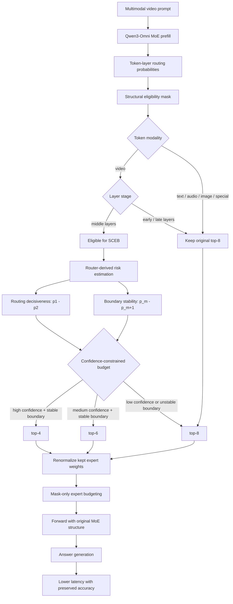
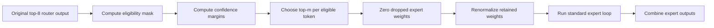

# Global SCEB Flow Chart

Current positioning:

> Global SCEB is the strongest current setting for the latency-accuracy tradeoff.
> It improves prefill and end-to-end latency over vanilla while preserving, and
> slightly improving, OmniVideoBench accuracy.

Current full-run anchor:

| Method | Accuracy | Prefill Mean | E2E Mean | Note |
|---|---:|---:|---:|---|
| Vanilla | 39.38% | 12540 ms | 15632 ms | original top-8 |
| Global SCEB | 39.68% | 11586 ms | 14516 ms | main setting |

## One-Slide Flow Chart



## Method Summary

Global SCEB applies expert-budget reduction only to structurally eligible
token-layer pairs:

- target modality: video;
- target layers: middle transformer layers;
- protected regions: text, audio, image, special/control tokens, early layers,
  and late layers.

For each eligible token-layer pair, SCEB assigns one of three expert budgets:

| Condition | Assigned Budget |
|---|---:|
| high routing decisiveness and stable top-4 boundary | top-4 |
| medium routing decisiveness and stable top-6 boundary | top-6 |
| otherwise | top-8 |

This makes the method a token-layer expert budget allocator rather than a
uniform top-k reduction.

## Implementation View



Important implementation detail:

Global SCEB is currently implemented as `confidence_dynamic_topk_mask`, not
compact dispatch. Dropped experts have zero routing weight, but the execution
path stays close to the original MoE forward. This is why it is numerically
stable and currently faster in practice than the compact-dispatch variant.

## Key Message For Presentation

```text
Uniform top-k asks: "How many experts should every token use?"

Global SCEB asks: "Which token-layer pairs can safely use fewer experts?"
```

That abstraction is the core of the method.
