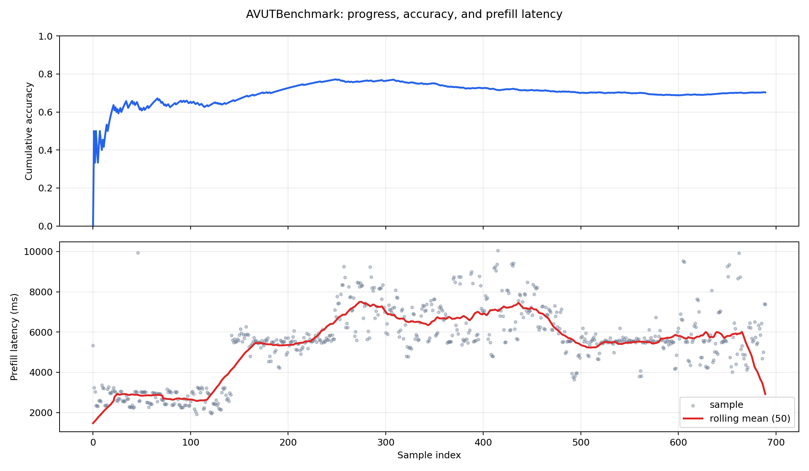
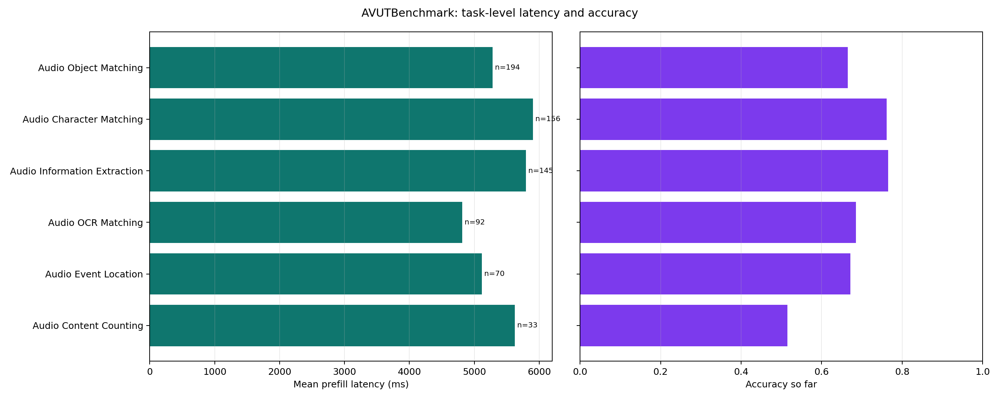
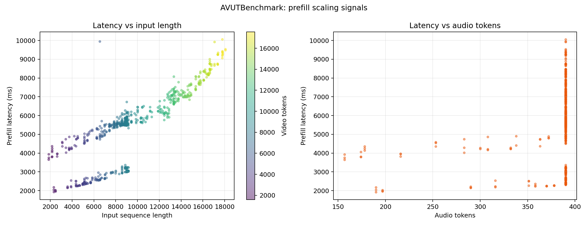
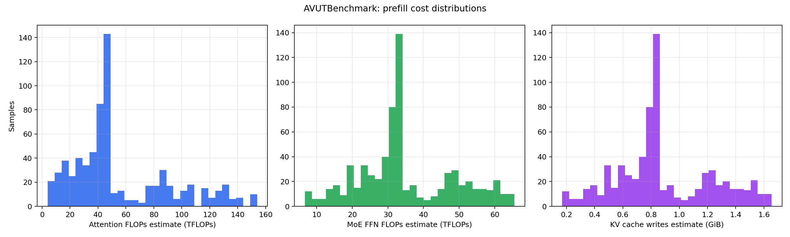
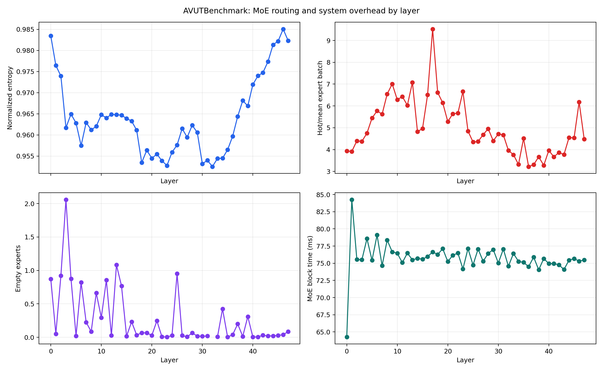
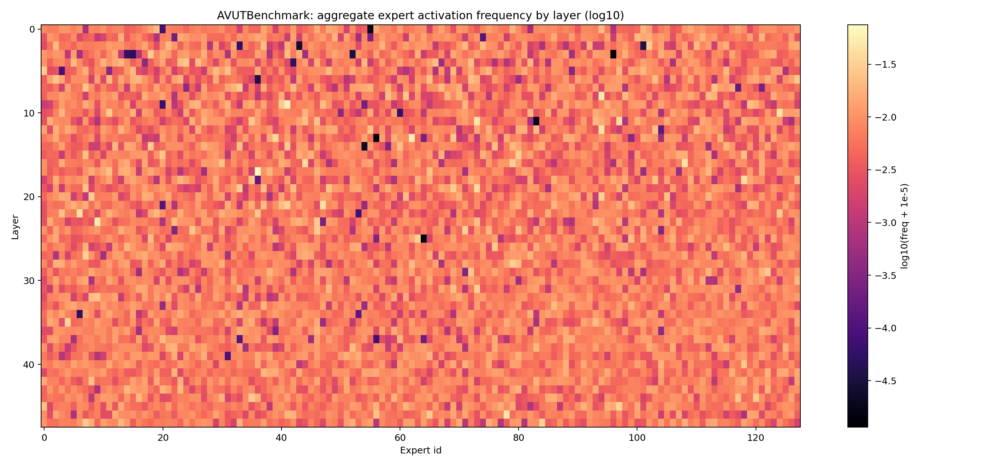
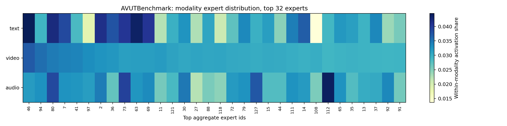
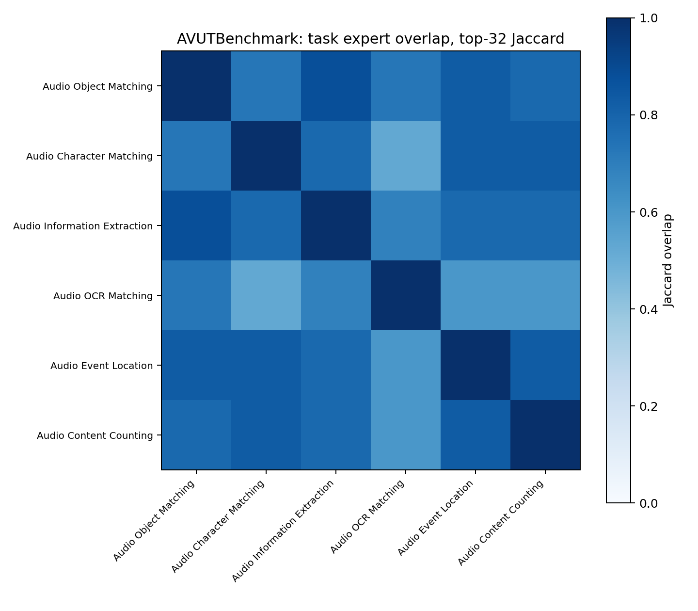

# AVUTBenchmark Profile Snapshot

- Snapshot time: `2026-06-11T21:44:48`
- Samples profiled: `690`
- Accuracy so far: `485/690` = `0.7029`
- Prefill latency mean / p50 / p95 / max: `5468.41` / `5564.03` / `8391.23` / `10056.30` ms
- Input seq len mean / p50 / p95 / max: `9609.71` / `9006.00` / `16582.10` / `18073.00`
- FlashAttention requested samples: `690`
- Chunked prefill observed samples: `0`

## Figures

## Global Top Experts

| rank | expert_id | activation_count | frequency |
|---:|---:|---:|---:|
| 1 | 46 | 27116320 | 0.01065 |
| 2 | 94 | 25922105 | 0.01018 |
| 3 | 80 | 25553400 | 0.01004 |
| 4 | 7 | 25001844 | 0.00982 |
| 5 | 41 | 24755437 | 0.00972 |
| 6 | 97 | 24121335 | 0.00947 |
| 7 | 2 | 23981893 | 0.00942 |
| 8 | 36 | 23563256 | 0.00925 |
| 9 | 73 | 23344870 | 0.00917 |
| 10 | 63 | 23267544 | 0.00914 |
| 11 | 69 | 23266537 | 0.00914 |
| 12 | 11 | 23097533 | 0.00907 |
| 13 | 121 | 22744100 | 0.00893 |
| 14 | 30 | 22604101 | 0.00888 |
| 15 | 27 | 22457815 | 0.00882 |
| 16 | 88 | 22418162 | 0.00880 |

## Task Stats

| task | n | acc | prefill mean ms | prefill p95 ms | input len mean |
|---|---:|---:|---:|---:|---:|
| Audio Object Matching | 194 | 0.6649 | 5283.73 | 8224.68 | 9403.79 |
| Audio Character Matching | 156 | 0.7613 | 5906.11 | 8209.12 | 9599.19 |
| Audio Information Extraction | 145 | 0.7655 | 5793.39 | 8768.62 | 10216.83 |
| Audio OCR Matching | 92 | 0.6848 | 4816.64 | 8432.73 | 9557.62 |
| Audio Event Location | 70 | 0.6714 | 5115.67 | 7888.17 | 9233.30 |
| Audio Content Counting | 33 | 0.5152 | 5622.42 | 8473.95 | 9145.94 |
