# OmniVideoBench Profile Snapshot

- Snapshot time: `2026-06-12T20:08:48`
- Samples profiled: `411`
- Accuracy so far: `167/411` = `0.4063`
- Prefill latency mean / p50 / p95 / max: `21643.86` / `28139.67` / `28661.58` / `29476.68` ms
- Input seq len mean / p50 / p95 / max: `43787.99` / `55799.00` / `55840.00` / `55990.00`
- FlashAttention requested samples: `411`
- Chunked prefill observed samples: `0`

## Figures

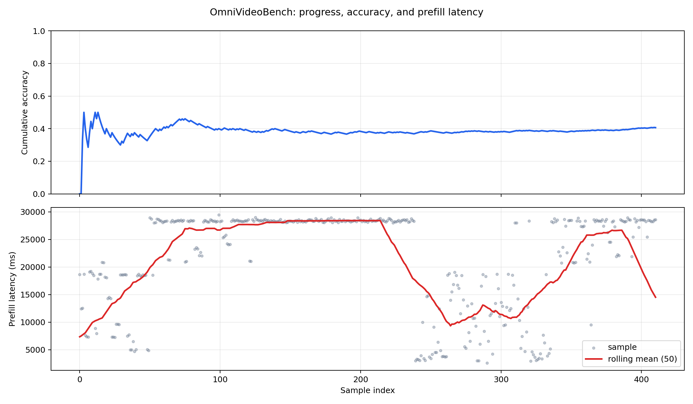

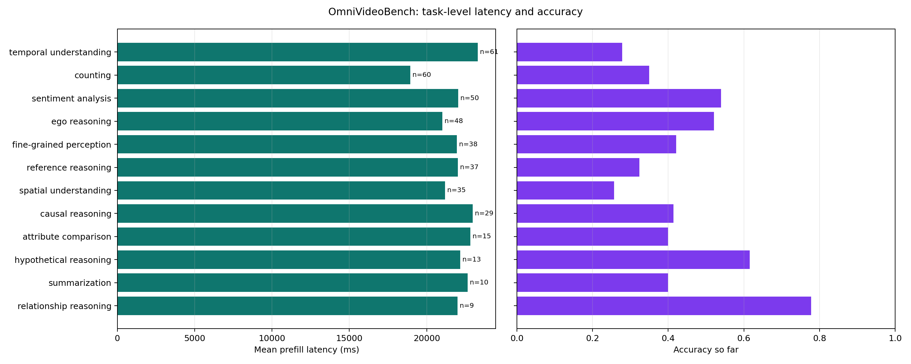

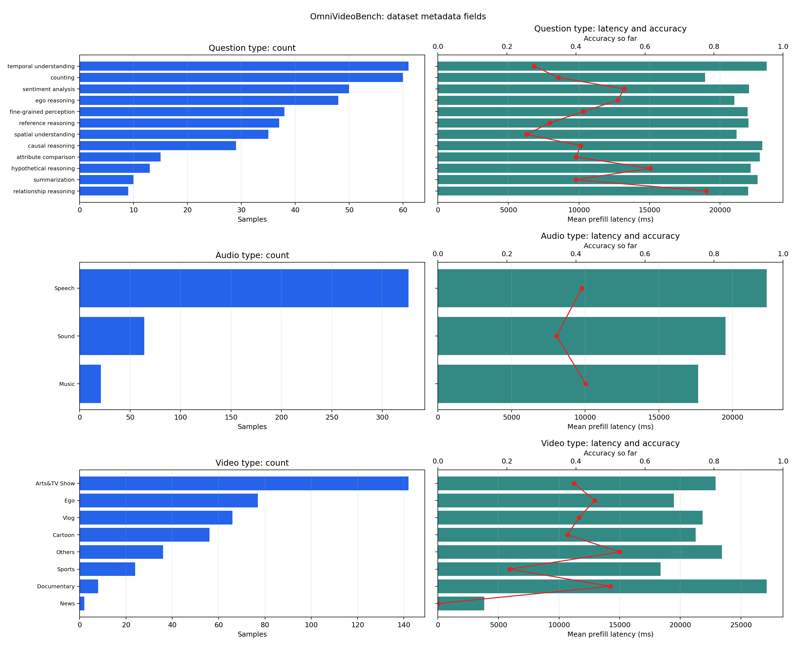

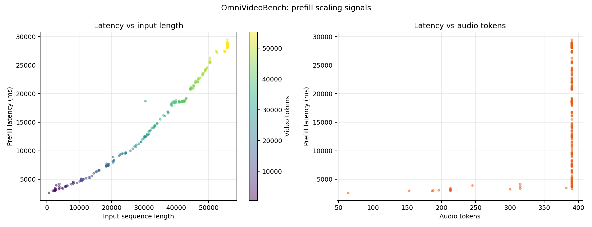

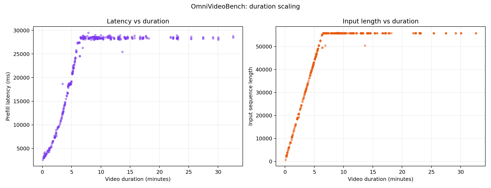

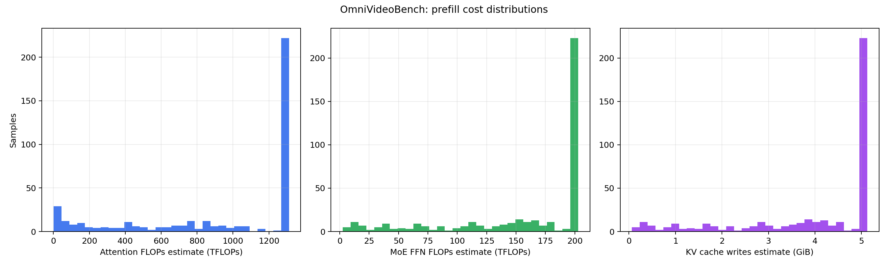

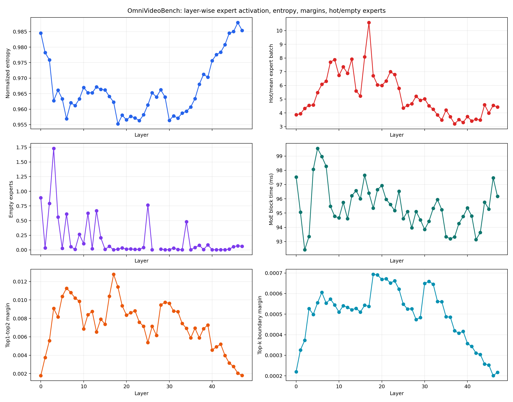

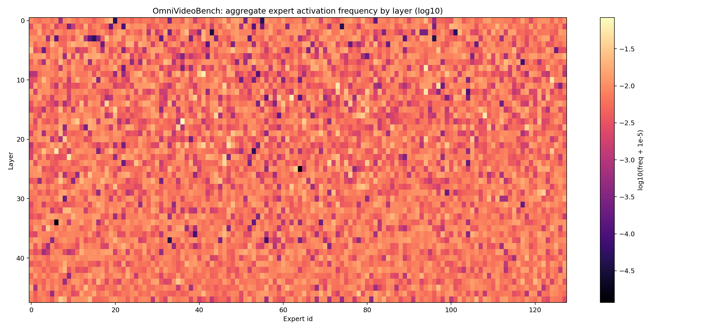

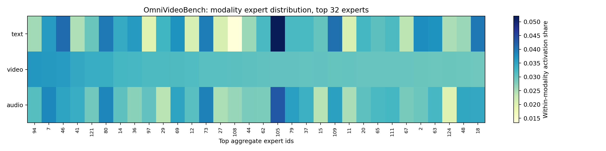

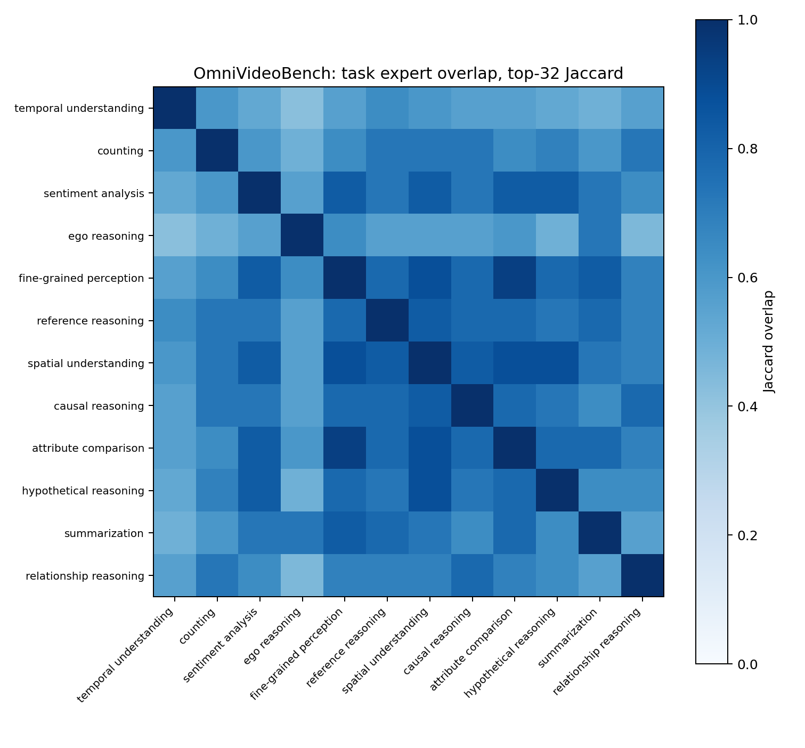

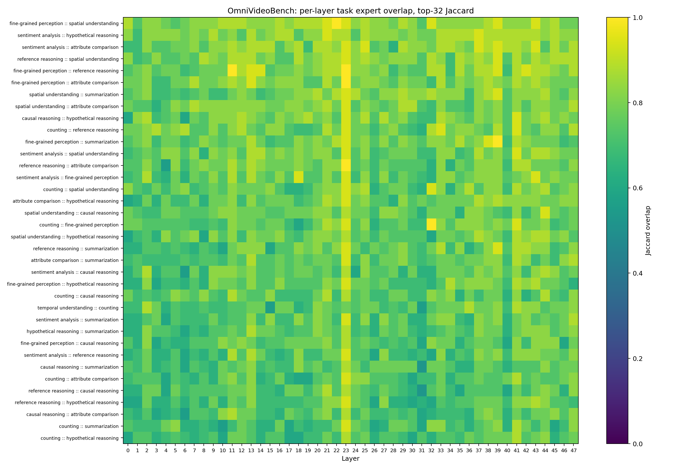

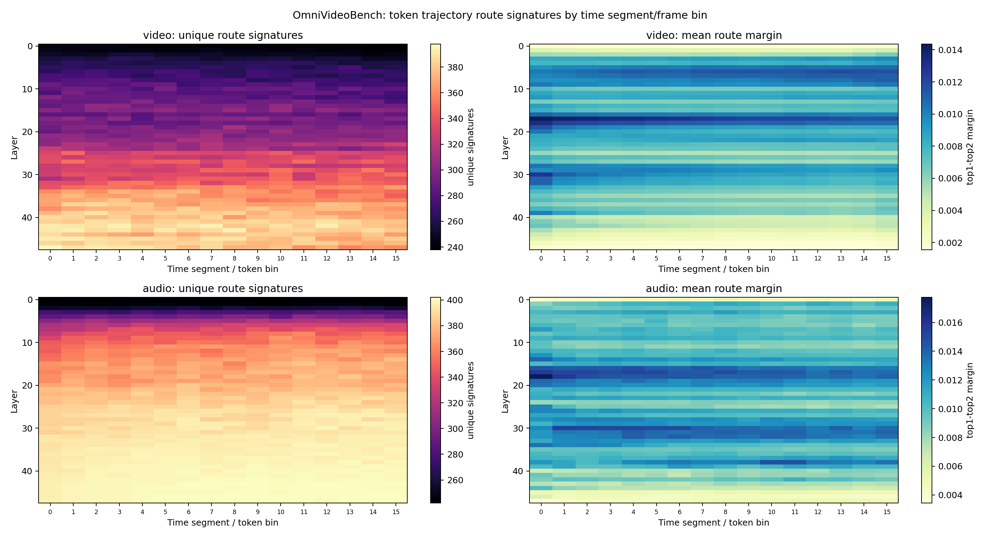

## Global Top Experts

| rank | expert_id | activation_count | frequency |
|---:|---:|---:|---:|
| 1 | 94 | 73642230 | 0.01066 |
| 2 | 7 | 73162655 | 0.01059 |
| 3 | 46 | 72605560 | 0.01051 |
| 4 | 41 | 69173764 | 0.01001 |
| 5 | 121 | 67925328 | 0.00983 |
| 6 | 80 | 67853906 | 0.00982 |
| 7 | 14 | 64869086 | 0.00939 |
| 8 | 36 | 64477798 | 0.00933 |
| 9 | 97 | 63799575 | 0.00923 |
| 10 | 29 | 63561268 | 0.00920 |
| 11 | 69 | 63550192 | 0.00920 |
| 12 | 12 | 63088169 | 0.00913 |
| 13 | 73 | 62131506 | 0.00899 |
| 14 | 27 | 61686883 | 0.00893 |
| 15 | 108 | 61378351 | 0.00888 |
| 16 | 44 | 61062184 | 0.00884 |

## Task Stats

| task | n | acc | prefill mean ms | prefill p95 ms | input len mean |
|---|---:|---:|---:|---:|---:|
| temporal understanding | 61 | 0.2787 | 23299.36 | 28613.31 | 47222.66 |
| counting | 60 | 0.3500 | 18943.47 | 28665.13 | 38372.22 |
| sentiment analysis | 50 | 0.5400 | 22043.01 | 28610.43 | 44409.58 |
| ego reasoning | 48 | 0.5208 | 21003.91 | 28732.97 | 42674.96 |
| fine-grained perception | 38 | 0.4211 | 21944.54 | 28781.06 | 43913.84 |
| reference reasoning | 37 | 0.3243 | 22017.83 | 28661.95 | 44454.11 |
| spatial understanding | 35 | 0.2571 | 21177.03 | 28429.70 | 44245.51 |
| causal reasoning | 29 | 0.4138 | 22987.30 | 28524.69 | 46646.55 |
| attribute comparison | 15 | 0.4000 | 22824.87 | 28769.16 | 44793.87 |
| hypothetical reasoning | 13 | 0.6154 | 22171.70 | 28879.82 | 44004.62 |
| summarization | 10 | 0.4000 | 22657.20 | 28498.79 | 45672.30 |
| relationship reasoning | 9 | 0.7778 | 22000.76 | 28524.06 | 44062.89 |
| background&music understanding | 6 | 0.5000 | 19309.37 | 28826.10 | 38824.00 |
